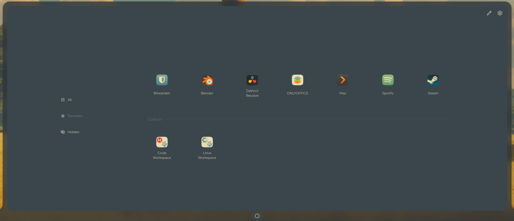
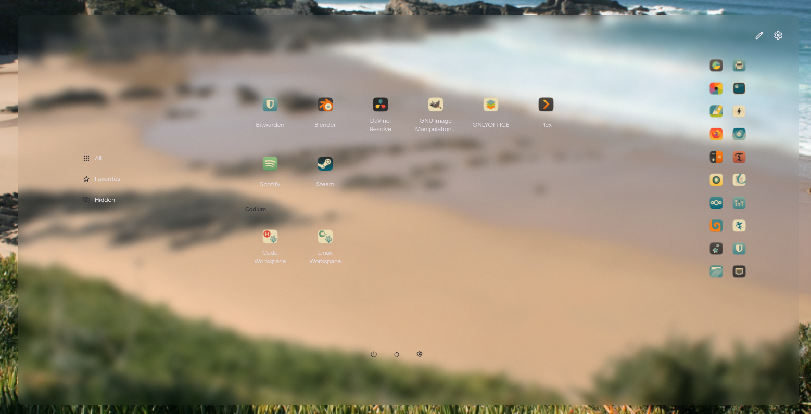
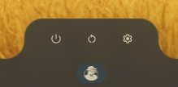
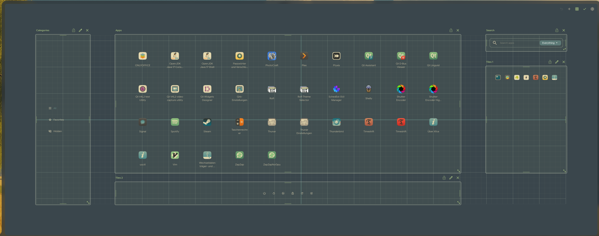

# CustomMenu

A highly customizable menu for the bar of [DMS (Dux Shell)](https://github.com/duxlabs-dev/dux-shell):
start menu, launcher, app tiles and buttons in one popout, arranged freely on a
grid. Vibecoded + tested.

The same plugin, other settings: translucent with blur over the
wallpaper, and as a mini bar with just three buttons.

Edit mode: move, resize and align the elements on the grid.

## Features

- **Free layout**: search field, categories, app list and tile elements sit on
  a grid. In edit mode you move, resize, align, lock, add
  and remove them.
- **Search like the DMS launcher**: same results and ranking, files and
  folders through DMS' file search, launcher plugins with their triggers.
  Result sections can be reordered and hidden. Folders can show a short badge
  instead of their path.
- **Categories**: DMS' categories plus your own (with Favorites). Reorder,
  hide or delete them, give them icons, add subcategories.
- **Tile elements**: pinned apps and buttons (lock, log out, reboot, shut down,
  DMS settings, open a folder, run a command, ...), as a grid or a row.
- **Profiles**: eight built-in looks; you can save your own.
- **Appearance**: four surface levels (menu, canvas, elements, chips/tiles)
  with DMS' surface colors or your own, transparency, blur, borders, corner
  radii and spacing. Each element can override the shared look.
- **Position and size**: docked to the bar like other DMS popouts, at a screen
  edge, or free on the screen; size in pixels, percent of the screen or
  fullscreen.
- **Several instances**: add the widget more than once, each with its own
  settings, data and keyboard shortcut.
- **Live preview**: with the settings open, the menu stays open next to them.
  Clicking a part of the menu jumps to its settings.
- **Translations**: English and German.

## Requirements

- DMS 2.0 or newer
- Tested on Hyprland. Other compositors supported by DMS should work, but are
  untested; moving the settings window next to the menu is Hyprland only.
- Optional: [dsearch](https://github.com/AvengeMedia/danksearch) for files
  and folders in the search (the same as for the DMS launcher)

## Installation

Once listed in the [DMS plugin registry](https://plugins.duxlabs.dev/),
install it from DMS settings › Plugins.

By hand:

    git clone https://github.com/PhulcZ/dms-custom-menu ~/.config/dms/plugins/CustomMenu

Then enable CustomMenu in DMS settings › Plugins and add it to a bar section
in the bar settings.

## Usage

- Click the bar icon, or bind a key to `dms ipc call customMenu toggle`
  (DMS settings › Input › Keyboard shortcuts, run a command). Further
  instances use `customMenu_<instance id>`; the plugin settings show the exact
  command for each instance.
- Pencil in the menu: edit mode. Gear: settings.
- Right-click an app for its options (pin to dock, hide, edit, launch on the
  dedicated GPU, uninstall Flatpaks).

## What it changes outside its own settings

- **Category assignments** stay in the plugin settings by default. With
  *Categories › Behavior › Assignments apply to: CustomMenu and DMS launcher*,
  dragging an app onto a category writes a copy of the app's desktop file to
  `~/.local/share/applications` with the changed category, and hiding uses
  DMS' hidden apps.
- **Edit App** works like in the DMS launcher (stored by DMS). With
  *Apps › Where app changes apply: System-wide*, it writes a desktop file to
  `~/.local/share/applications` instead. *Reset* moves only files written by
  CustomMenu (marked `X-CustomMenu-Override=true`) to the trash.

## Note on DMS internals

DMS has no public API for some of what CustomMenu does: joining the frame of a
docked popout, the opening animation and position, the launcher's search
controller and the category list. CustomMenu uses DMS' internal properties
for these (most of them in `components/menu/PopoutChrome.qml`). They work
with DMS 2.0, but a DMS update may change them and break parts of the menu.

## Made with AI

This plugin was written with the help of AI (Claude Opus 5.5). The author
designed it and tested every feature.

## For DMS maintainers

You are welcome to take any part of this code into DMS itself.

## Code structure

| Path | What |
|---|---|
| `plugin.json` | Entry point: id, name, the two main files |
| `CustomMenuWidget.qml` | The widget: settings as used (`cfg`), state and logic (apps, categories, search, tiles, layout, undo, keyboard), wrappers for the popout internals. Sections are marked `// ── Title ──` |
| `CustomMenuSettings.qml` | The settings page: instance and profile bars, load/save of the edited instance, the six top-level sections |
| `components/menu/` | Parts of the menu: `MenuPopout` (popout content: canvas, grid, toolbars), the elements (`SearchElement`, `CategoriesElement`, `AppsElement`, `TilesElement`), the editors (`TilesEditor`, `CategoryEditor`), `PopoutChrome` (the DMS internals above), smaller pieces |
| `components/settings/` | Parts of the settings page: one file per top-level section (`Settings*.qml`), the lazily built `Section`, the setting controls |
| `components/common/` | Used by both: `FlexIcon`, `IconPicker`, `DmsAppLists` |
| `Defaults.js` | Default values |
| `Templates.js` | Profile logic (values, size, arrangement, switching) |
| `BuiltInTemplates.js` | The built-in profiles (data) |
| `LayoutFit.js`, `TileLayout.js` | Pure layout math (no QML): fitting elements into the grid, scaling and storing the arrangement, placing tiles |
| `ColorRoles.js`, `FontLogos.js` | Color roles beyond DMS' and the distro logo font |
| `translations/de.json` | German texts; English is the source text in the code |
| `assets/` | Material Symbols names and the font-logos font (see `assets/NOTICE`) |

Components of `components/menu/` get the widget as `menu` (the popout lives
in its own window, so they cannot find it through their parents); those of
`components/settings/` find the settings page through their parents.

After changing a file in `components/` or a `.js` file, restart DMS
(`systemctl --user restart dms`); `dms ipc call plugins reload customMenu`
reloads only the main files.

### Tests

    node tests/logic.test.js

Tests of the pure logic (`LayoutFit.js`, `TileLayout.js`, category keys in
`Defaults.js`).

## License

MIT, see [LICENSE](LICENSE). Material Symbols names: Google LLC, Apache
License 2.0. font-logos: Unlicense. Details in [assets/NOTICE](assets/NOTICE).
